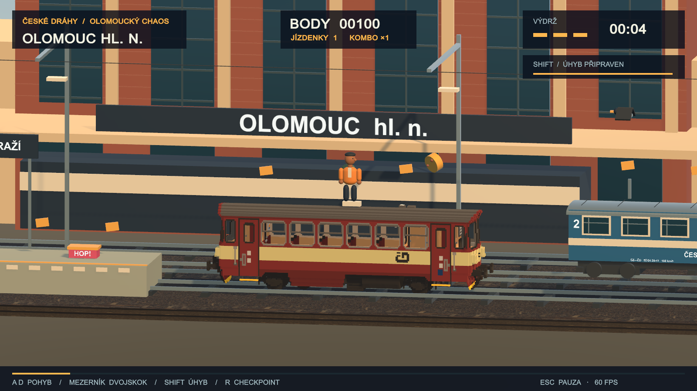

# České dráhy — Olomoucký chaos

Goofy 2,5D plošinovka v **Unity 6000.6.8f1**. David, mladý Rom z Olomouce, má platnou jízdenku a spěchá na poslední spoj. Na olomouckém hlavním nádraží skáče po vagonech, vyhýbá se holubům a revizorům a v podchodu potká fiktivní postavy s obřími injekcemi.

Tři úseky vedou od výpravní budovy přes podchod až na páté nástupiště. Pružící kufry fungují jako odrazové můstky a tvarůžkové turbo na chvíli zrychlí běh.

**[Stáhnout verzi pro macOS (Apple Silicon)](https://github.com/JanRichtermoc/Ceske_drahy/releases/tag/v0.2.0)**


## Spuštění

1. Přidej tuto složku v Unity Hub a otevři ji v Unity **6000.6.8f1**.
2. Otevři `Assets/Scenes/OlomoucHlavniNadrazi.unity`.
3. Stiskni **Play**, potom **Enter** nebo „Na nástupiště“.

Scéna obsahuje herní bootstrap; prostředí se vytváří při spuštění. Příkaz **České dráhy → Prepare game scene** ji znovu vytvoří. Příkaz **České dráhy → Build macOS** sestaví samostatnou aplikaci do `Builds/CeskeDrahy.app`. Pro Windows lze scénu sestavit přes Unity Build Profiles po instalaci Windows Build Support.

## Ovládání

| Klávesa | Akce |
|---|---|
| A/D nebo šipky | Pohyb |
| Mezerník, W nebo ↑ | Skok, další stisk ve vzduchu provede dvojskok |
| Shift | Rychlý úhyb, po použití se krátce dobíjí |
| Esc | Pauza / pokračování |
| R | Návrat na poslední checkpoint |
| M | Zapnutí / vypnutí zvuku |
| Enter | Start / nový pokus |

Sbírej jízdenky a skákej na protivníky shora. Rychlý sled těchto akcí zvyšuje násobič bodů až na ×5. Žlutá kontrolka předchází hodu revizorovy brašny, zelená signalizuje létající injekci. Nákaza na čas zpomalí běh. Lékárnička ji odstraní a doplní jeden život. Pád stojí jeden život, dosažení checkpointu doplní výdrž alespoň na dva životy. Ztráta zaostření okna hru pozastaví.



Zásah spustí skutečný řev a náraz. Postavy v podchodu vykřikují české nesmysly, například „Rohlík má přednost v jízdě!“ Hlasitost řevu má vlastní ovladač. Původ nahrávek a syntetických hlasů je v [přehledu zvuku](docs/AUDIO.md).

## Implementace a výkon

- Kinematický pohyb ve 120Hz pevném kroku s detekcí přechodu přes střechu, tolerancí skoku po opuštění hrany a bufferem vstupu.
- Pohyblivé vagony přenášejí hráče; animované postavy, holubi a sběratelné předměty.
- Dva pooly po 12 projektilech, sdílené materiály, komprimované textury kolejiště do 1024 px, omezená vzdálenost stínů.
- Model ČD 810 má přibližně 27 tisíc trojúhelníků. Ostatní vagony, prostředí a postavy jsou vytvářené z geometrie v projektu.
- Úsporný režim vypíná stíny a MSAA; zvuk a otřesy kamery mají samostatné volby. Nastavení a rekord se ukládají lokálně.
- Cíl je 60 FPS. Výkon závisí na zařízení; benchmark a omezení jsou v `docs/VALIDATION.md`.

## Unity přes MCP

Projekt používá Unity Pipeline 1.0.0. S otevřeným editorem a nainstalovaným Unity CLI:

```sh
python3 Tools/unity_mcp.py
python3 Tools/unity_mcp.py eval '{"code":"return UnityEngine.Application.unityVersion;"}'
python3 Tools/unity_mcp.py eval '{"code":"UnityEditor.EditorApplication.isPlaying=true;"}'
python3 Tools/unity_mcp.py eval '{"code":"return RailSmokeTests.Run();"}'
```

Poslední příkaz spouští šestnáct integračních kontrol v Play Mode. Průchodnost trati testuje s vypnutým zraněním; zranění, nezranitelnost a prohra se ověřují samostatně. Testy nejsou náhradou uživatelského testování obtížnosti.

## Předlohy a licence

Průčelí, hodiny a přístřešky jsou vlastní stylizovaná geometrie inspirovaná olomouckým hlavním nádražím. [Správa železnic – rekonstrukce stanice](https://www.spravazeleznic.cz/pro-media/tiskovy-servis-tiskove-zpravy-prohlaseni/rekonstrukce-zst.olomouc)


- [Railway Track 3D scan](https://sketchfab.com/3d-models/railway-track-3d-scan-21a0ed90f355495fb80c3dcc92a94b10) — **grafi**, [CC BY 4.0](https://creativecommons.org/licenses/by/4.0/). Barevná a normálová textura zmenšena na 1024 px, použita na kolejovém loži.
- [CD810 motor train](https://sketchfab.com/3d-models/cd810-motor-train-121922992c4c44c9a121a40c82c79382) — **voxellation**, [CC BY 4.0](https://creativecommons.org/licenses/by/4.0/). Import glTF do Unity, upravené měřítko pro herní plošiny.

Původní licenční soubory a strojově čitelné atribuce jsou ve složce `docs`. Ke stažení byl použit oficiální Sketchfab Download API. API klíč není součástí projektu ani historie Gitu. Obnovitelné stažení:

```sh
python3 Tools/sketchfab_download.py 121922992c4c44c9a121a40c82c79382
```

Nástroj si klíč vyžádá skrytým vstupem, případně přečte proměnnou `SKETCHFAB_API_TOKEN`. Hra funguje offline a klíč nepotřebuje.

Osobní fanouškovský projekt; není oficiální hrou Českých drah. Neobsahuje grafiku, hudbu ani úrovně ze Super Mario Bros.
