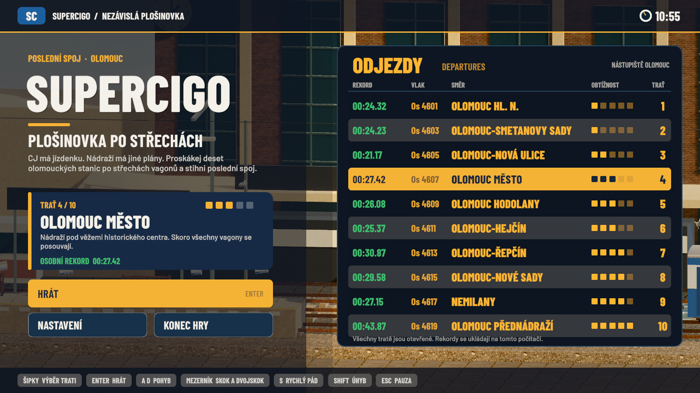
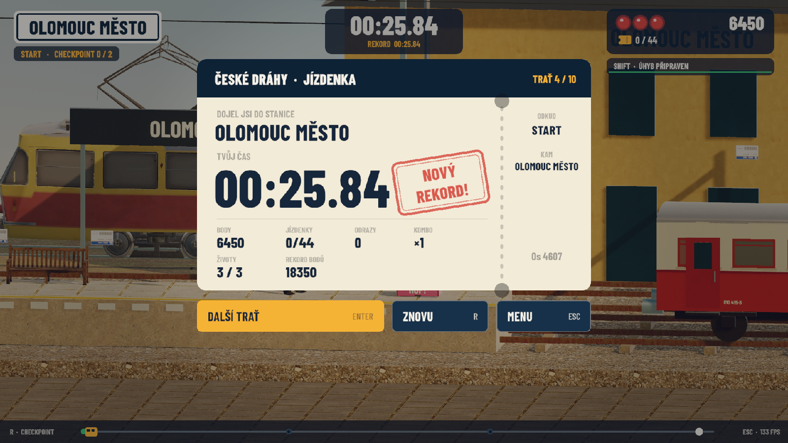
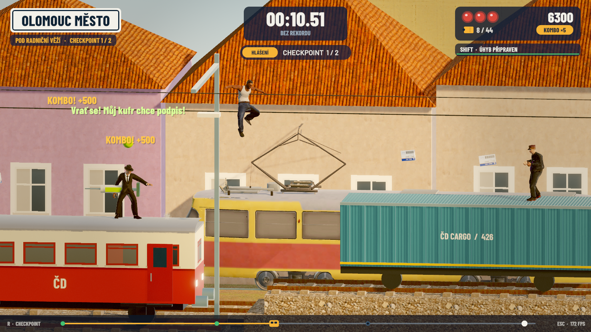

# České dráhy — Olomoucký chaos

2,5D arkádová plošinovka v **Unity 6000.6.8f1**. Carl „CJ“ Johnson se snaží stihnout poslední spoj. Cestou proskáče **deset skutečných železničních stanic Olomouce** po střechách vagonů, cisteren a kontejnerů. Pod nohama mu přitom překážejí revizoři, holubi, pára a podchodoví alchymisté s obřími injekcemi.



## Tratě

Názvy odpovídají stanicím a zastávkám v Olomouci (cs.wikipedia, kategorie *Železniční stanice v Olomouci*). Kulisy jsou stylizované, ne přesné modely.

| # | Stanice | Kulisy a novinka | Obtížnost |
|---|---|---|---|
| 1 | Olomouc hl. n. | výpravní budova, podchod, výuka dvojskoku a kufrů | ● |
| 2 | Olomouc-Smetanovy sady | park, pavilon Výstaviště Flora, Palmový skleník, víc kufrových pružin | ● |
| 3 | Olomouc-Nová Ulice | Fakultní nemocnice, sanitky, tramvaj Tatra T3, víc injekcí i lékárniček | ●● |
| 4 | Olomouc město | měšťanské domy, věže sv. Mořice, radnice, katedrály sv. Václava a Sloup Nejsvětější Trojice, posouvající se vagony | ●●● |
| 5 | Olomouc Hodolany | lokomotivní depo, výtrysky páry | ●●● |
| 6 | Olomouc-Hejčín | most přes řeku Moravu, topoly, pád do vody | ●●● |
| 7 | Olomouc-Řepčín | vlečky, sila, kontejnery, vysoké cisterny, soumrak | ●●●● |
| 8 | Olomouc-Nové Sady | sídliště za protihlukovou stěnou, večer, pára a revizoři | ●●●● |
| 9 | Nemilany | pole a větrolamy při západu slunce, nárazy protivětru | ●●●● |
| 10 | Olomouc přednádraží | noční seřadiště, finále se dvěma životy | ●●●●● |

Všechny tratě jsou odemčené hned. Každá má dva checkpointy, které se při příjezdu ohlásí zeleným návěstidlem. Po dojetí do cíle se ukáže **jízdenka s časem**, osobním rekordem trati (razítko „NOVÝ REKORD“), body, jízdenkami, odrazy a kombem. Rekordy se ukládají lokálně a zobrazují se v menu.



## Ovládání

| Klávesa | Akce |
|---|---|
| A / D nebo ← / → | pohyb |
| Mezerník, W nebo ↑ | skok; další stisk ve vzduchu = dvojskok; krátký stisk = nižší skok |
| Shift | rychlý úhyb (krátce nezranitelný, pak se nabíjí) |
| R | návrat na checkpoint; na výsledkové obrazovce restart trati |
| Esc | pauza / pokračování; na výsledkové obrazovce hlavní menu |
| Enter | start vybrané trati / další trať / nový pokus |
| ↑ / ↓ (W / S) v menu | výběr trati na odjezdové tabuli |
| M | zapnutí / vypnutí zvuku |

Sbírej jízdenky a skákej protivníkům na hlavu. Rychlý sled akcí zvyšuje násobič až na ×5. Žlutá kontrolka znamená, že revizor hodí brašnu, zelená ohlašuje létající injekci. Oranžové blikání u roštu varuje před párou. V Nemilanech nejdřív zabliká větrná výstraha, pak přijde poryv. Nákaza zpomaluje a lékárnička ji vyléčí a vrátí život. Pád stojí jeden život. Ztráta zaostření okna hru pozastaví.



## Spuštění

### Windows (hotový build)
1. Rozbal `CeskeDrahy-Windows.zip`. Vzniká v `Builds/` po sestavení (viz níže), do Gitu se binárky neukládají.
2. Ve složce `CeskeDrahy` spusť `CeskeDrahy.exe`. Složka `CeskeDrahy_Data`, `UnityPlayer.dll` a `MonoBleedingEdge` musí zůstat vedle exe.
3. Při prvním spuštění může Windows SmartScreen zobrazit varování „Systém Windows ochránil váš počítač“, protože build není podepsaný. Klikni na **Další informace → Přesto spustit**.

Požadavky: Windows 10/11 x64, grafika s DirectX 11. Okno lze měnit, celá obrazovka jde zapnout v Nastavení nebo přes Alt+Enter.

### macOS
`Builds/CeskeDrahy.app` (Apple Silicon) po sestavení přes **České dráhy → Build macOS**.

### Z Unity editoru
1. V Unity Hub přidej tuto složku a otevři ji v Unity **6000.6.8f1**.
2. Otevři `Assets/Scenes/OlomoucHlavniNadrazi.unity` a stiskni **Play**.
3. Sestavení: menu **České dráhy → Build Windows** (výstup `Builds/Windows/CeskeDrahy/CeskeDrahy.exe` a `Builds/CeskeDrahy-Windows.zip`) nebo **České dráhy → Build macOS**. Pro Windows build je potřeba modul *Windows Build Support (Mono)*.

## Testy

- **EditMode testy** (`Assets/Tests/Editor`, Unity Test Framework). Spusť je ve *Window → General → Test Runner → EditMode → Run All*. Zahrnují 54 statických kontrol všech tratí (unikátní klíče rekordů, shoda druhů plošin, zón a stanic, entity stojí na plošinách, dosažitelnost každé mezery podle fyziky skoku a checkpointy na nástupištích) a jeden integrační test, který sám vstoupí do Play Mode.
- **Integrační kontroly** (`RailSmokeTests.Run()`), celkem 28. Ověřují dopad, zranění a nezranitelnost, prohru i to, že se po ní už nesbírají předměty. Dál pád a checkpoint, variabilní skok, coyote time, buffer skoku, holuba, brašnu revizora, vezení na vagonu, kufr (puštění skoku ho nezkrátí), dvojskok, úhyb, nákazu, lékárničku, páru a uložení rekordu času. Skriptovaný běžec projede všech 10 tratí a nakonec se ověří úklid při návratu do menu. Testy po sobě obnoví hráčovy rekordy.
- **Ruční testovací scénář**: [docs/TESTOVANI.md](docs/TESTOVANI.md).

Z příkazové řádky přes Unity CLI (MCP Pipeline):

```sh
~/.unity/bin/unity cmd test run --mode EditMode --async-tests true
~/.unity/bin/unity cmd test status
```

## Použité technologie

- **Unity 6000.6.8f1**, C#, Built-in Render Pipeline, lineární barevný prostor, IMGUI rozhraní.
- Svět, tratě a kulisy se generují z dat za běhu (`RailLevel`, `RailWorld`, `OlomoucBackdrops`). Pohyb má pevný krok 120 Hz s interpolací vykreslení pro monitory 75–165 Hz.
- Vlastní shadery: `Railway/Surface` (PBR, rim světlo podle oblohy, procedurální patina, kontaktní stín, emisní mapy, triplanární mapování v metrech), `Railway/Foliage` (vítr), `Railway/Water` (řeka Morava), obloha s mraky a hvězdami, post-process `RailPost` (bloom, ACES, barevné ladění podle denní doby, vinětace).
- **glTFast** pro import modelů, **Blender 5.2** (headless skripty v `Tools/blender`) pro úpravu modelů, **Sketchfab Download API** (`Tools/sketchfab_download.py`).
- **Unity CLI / MCP Pipeline** (`Tools/unity_mcp.py`) pro řízení editoru, testy a buildy.
- Fonty Barlow a Barlow Condensed (OFL), PBR textury ambientCG (CC0), zvuky z Freesound (CC0) a hlas Piper.

## Struktura

```
Assets/Scripts        herní kód (assembly CeskeDrahy)
  RailGame.cs         stavový automat, pohyb, kolize, checkpointy, rekordy
  RailLevel.cs        data 10 tratí
  RailWorld.cs        stavba trati, vagony, světlo, materiály
  OlomoucBackdrops.cs kulisy jednotlivých stanic
  RailChaos.cs        arkádová pravidla (kombo, nákaza, pružiny, protivníci)
  RailHUD.cs          menu, HUD, pauza, výsledková jízdenka, nastavení
  CjRig.cs            proxy kostra a retarget na skinned model CJ
  RailPost.cs         post-processing
Assets/Resources      shadery, materiály, modely, textury, fonty, zvuky
Assets/Tests/Editor   EditMode testy a integrační kontroly
Assets/Editor         příprava scény a buildy
Tools                 Sketchfab, Unity MCP, Blender skripty
docs                  design, testování, licence, podklady
```

## Předlohy a licence

3D modely ze Sketchfabu (CC BY 4.0, atribuce a licence v `docs/*-attribution.json` a `docs/*-license.txt`):

- [Free Rigged Male Basemesh](https://sketchfab.com/3d-models/free-rigged-male-basemesh-b8de3373addd4decac40400ee96c62e0) – **Filip**. Tělo CJ: v Blenderu oblečené (tílko, džíny, tenisky, vlasy), převedené do metrů a řízené herní kostrou.
- [Tatra t3 (reworked)](https://sketchfab.com/3d-models/tatra-t3-reworked-a932f7c3850643fd92dadad7f5771d6c) – **Randonavt**. Tramvaj, zjednodušená ze 141 tisíc na 26 tisíc trojúhelníků.
- [Wooden Park Bench](https://sketchfab.com/3d-models/wooden-park-bench-e53ad46c604c44e59a98bad27041cb19) – **TheMadraver**. Lavičky na nástupištích.
- [Low-Poly Lamp Post](https://sketchfab.com/3d-models/low-poly-lamp-post-c466684e819a4428b6d8ed50537615e4) – **Memorie**. Lampy na nástupištích.
- [CD810 motor train](https://sketchfab.com/3d-models/cd810-motor-train-121922992c4c44c9a121a40c82c79382) – **voxellation**. Motorový vůz.
- [Railway Track 3D scan](https://sketchfab.com/3d-models/railway-track-3d-scan-21a0ed90f355495fb80c3dcc92a94b10) – **grafi**. Kolejové lože.
- [Brick wall material](https://sketchfab.com/3d-models/brick-wall-material-6ef775e935da4d159e40098b06ad33d3) – **Ilya.Krupenkov**. Zdivo.
- [Cracked Concrete Old 3D Scan](https://sketchfab.com/3d-models/cracked-concrete-old-3d-scan-2d01ca3fd8fb4e96bf591110389a128c) – **grafi**. Nástupiště.

Textury: [docs/TEXTURES.md](docs/TEXTURES.md) (ambientCG, CC0). Zvuky: [docs/AUDIO.md](docs/AUDIO.md). Fonty: Barlow, SIL Open Font License ([docs/fonts-OFL.txt](docs/fonts-OFL.txt)).

Ke stažení modelů slouží oficiální Sketchfab Download API. Klíč se zadává skrytě nebo proměnnou `SKETCHFAB_API_TOKEN` a není součástí projektu ani historie Gitu:

```sh
SKETCHFAB_API_TOKEN=... python3 Tools/sketchfab_download.py a932f7c3850643fd92dadad7f5771d6c --output .local/tatra
"/Applications/Blender.app/Contents/MacOS/Blender" --background --factory-startup \
  --python Tools/blender/prop_import.py -- .local/tatra/scene.gltf Assets/Resources/Models/Props/tatra_t3.glb length 14.6 26000 512
```

CJ je postava z Grand Theft Auto: San Andreas od Rockstar Games. Tento fanouškovský školní projekt nepoužívá žádné soubory z GTA. Postava vznikla z volně licencovaného basemeshe a vlastních materiálů. Hra není oficiálním produktem Českých drah ani Rockstar Games.
