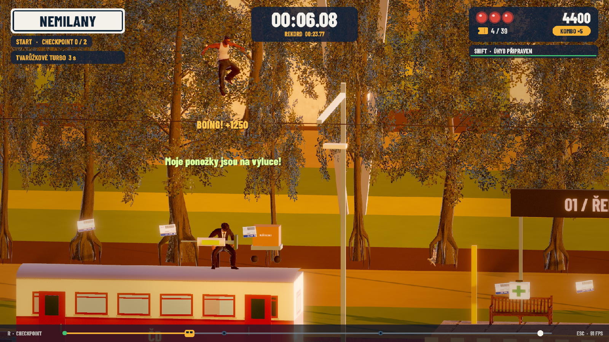
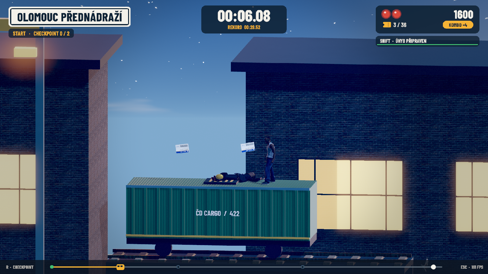

# SuperCigos

**[⬇ Windows (ZIP)](https://github.com/JanRichtermoc/Ceske_drahy/releases/latest/download/SuperCigos-Windows.zip)** · **[⬇ macOS – Apple silicon i Intel (ZIP)](https://github.com/JanRichtermoc/Ceske_drahy/releases/latest/download/SuperCigos-macOS.zip)** · [všechna vydání](https://github.com/JanRichtermoc/Ceske_drahy/releases)


## Popis hry

*SuperCigos* je 2,5D arkádová plošinovka pro jednoho hráče. Carl „CJ“ Johnson se snaží stihnout poslední spoj. Cestou proskáče **deset skutečných železničních stanic Olomouce** po střechách vagonů, cisteren a kontejnerů. Pod nohama mu přitom překážejí revizoři s brašnami, holubi, pára a podchodoví alchymisté s obřími injekcemi.

**Cíl:** projet každou trať od startovního nástupiště do cíle co nejrychleji. Po dojetí se ukáže **jízdenka s časem** a osobním rekordem trati (razítko „NOVÝ REKORD“), dále body, sebrané jízdenky, odrazy a nejvyšší kombo. Rekordy se ukládají lokálně a zobrazují se v menu na odjezdové tabuli.

**Pravidla:**
- Každá trať má dva checkpointy na nástupištích. Při příjezdu se návěstidlo přepne na zelenou a po pádu se hráč vrací sem.
- Na začátku má hráč 3 životy, na poslední trati 2. Pád mezi vagony nebo zásah stojí jeden život. Po ztrátě všech životů „ujel vlak“ a trať se opakuje.
- Jízdenky a skok protivníkům na hlavu dávají body. Rychlý sled akcí zvyšuje násobič až na ×5.
- Varování před útoky: žlutá kontrolka znamená, že revizor hodí brašnu, zelená ohlašuje létající injekci. Oranžové blikání roštu varuje před párou a v Nemilanech výstraha ohlašuje poryv protivětru.
- Injekce způsobí nákazu, která zpomaluje. Lékárnička ji vyléčí a vrátí život (nejvýš do počtu životů trati). Krabička tvarůžků dá krátké zrychlení a růžový kufr vystřelí vysoko.
- Ztráta zaostření okna hru pozastaví a čas se během pauzy nepočítá.

### Tratě

Názvy odpovídají stanicím a zastávkám v Olomouci (cs.wikipedia, kategorie *Železniční stanice v Olomouci*). Kulisy jsou stylizované, nejde o přesné modely. Všechny tratě jsou odemčené hned.

| # | Stanice | Kulisy a novinka | Obtížnost |
|---|---|---|---|
| 1 | Olomouc hl. n. | výpravní budova, podchod, výuka dvojskoku a kufrů | ● |
| 2 | Olomouc-Smetanovy sady | park, pavilon Výstaviště Flora, Palmový skleník, víc kufrových pružin | ● |
| 3 | Olomouc-Nová Ulice | Fakultní nemocnice, sanitky, tramvaj Tatra T3, víc injekcí i lékárniček | ●● |
| 4 | Olomouc město | měšťanské domy, věže sv. Mořice, radnice, katedrála sv. Václava a Sloup Nejsvětější Trojice, posouvající se vagony | ●●● |
| 5 | Olomouc Hodolany | lokomotivní depo, výtrysky páry | ●●● |
| 6 | Olomouc-Hejčín | most přes řeku Moravu, topoly, pád do vody | ●●● |
| 7 | Olomouc-Řepčín | vlečky, sila, kontejnery, vysoké cisterny, soumrak | ●●●● |
| 8 | Olomouc-Nové Sady | sídliště za protihlukovou stěnou, večer, pára a revizoři | ●●●● |
| 9 | Nemilany | pole a větrolamy při západu slunce, nárazy protivětru | ●●●● |
| 10 | Olomouc přednádraží | noční seřadiště, finále se dvěma životy | ●●●●● |


| Nemilany při západu slunce | Noční přednádraží |
|---|---|
|  |  |

## Ovládání

Hra se ovládá klávesnicí; v menu jde použít i myš. Funguje také herní ovladač (Xbox / PlayStation).

| Klávesa | Ovladač | Akce |
|---|---|---|
| A / D nebo ← / → | levá páčka, D-pad | pohyb doleva / doprava |
| Mezerník, W nebo ↑ | A / ✕ | skok; další stisk ve vzduchu = dvojskok; krátký stisk = nižší skok |
| S nebo ↓ (ve vzduchu) | páčka / D-pad dolů | rychlý pád |
| Shift | X / ▢ nebo RB | rychlý úhyb (krátce nezranitelný, pak se nabíjí) |
| R | Y / △ | návrat na poslední checkpoint; na výsledkové obrazovce opakování trati |
| Esc | Start | pauza / pokračování; na výsledkové obrazovce návrat do menu; zavření nastavení |
| Enter | A / ✕ | start vybrané trati / další trať / nový pokus |
| ↑ / ↓ (W / S) v menu | D-pad | výběr trati na odjezdové tabuli (také najetím myší) |
| M | | zapnutí / vypnutí zvuku |
| Alt + Enter (jen Windows) | | celá obrazovka / okno; na Macu přes Nastavení nebo zelené tlačítko okna |


## Postup spuštění

### Windows
1. Stáhni **[SuperCigos-Windows.zip](https://github.com/JanRichtermoc/Ceske_drahy/releases/latest/download/SuperCigos-Windows.zip)**.
2. Klikni na ZIP pravým tlačítkem a zvol **Extrahovat vše…**. Hra nejde spustit přímo z neotevřeného ZIPu.
3. Ve složce `SuperCigos` spusť **`SuperCigos.exe`**. Celá složka musí zůstat pohromadě: `UnityPlayer.dll`, `SuperCigos_Data` a `MonoBleedingEdge` leží vedle exe.
4. Build není podepsaný, takže Windows SmartScreen může ukázat „Systém Windows ochránil váš počítač“. Klikni na **Další informace → Přesto spustit**.

Požadavky: Windows 10 nebo 11 (64 bit), grafická karta s DirectX 11, asi 250 MB volného místa. Instalace ani internet nejsou potřeba.

### macOS (Apple silicon i Intel)
1. Stáhni **[SuperCigos-macOS.zip](https://github.com/JanRichtermoc/Ceske_drahy/releases/latest/download/SuperCigos-macOS.zip)** a rozbal ho dvojklikem. Aplikaci `SuperCigos.app` můžeš přesunout do složky Aplikace.
2. Aplikace je podepsaná jen lokálně (ad hoc), ne certifikátem Apple Developer, takže ji macOS při prvním spuštění zablokuje:
   - **macOS 15 a novější:** otevři aplikaci, v hlášce „Apple nemohl ověřit…“ klikni na **Hotovo**. Pak otevři **Nastavení systému → Soukromí a zabezpečení**, dole u „Aplikace SuperCigos byla zablokována“ klikni na **Přesto otevřít** a potvrď heslem.
   - **macOS 13–14:** klikni na aplikaci pravým tlačítkem, zvol **Otevřít** a v dialogu znovu **Otevřít**.
3. Pokud macOS hlásí, že je aplikace **„poškozená“**, odstraň karanténní příznak v Terminálu (uprav cestu podle toho, kde aplikace je):
   ```sh
   xattr -dr com.apple.quarantine ~/Downloads/SuperCigos.app
   ```

Požadavky: macOS 12 nebo novější, Mac s Apple silicon nebo Intel (universal aplikace).

### Ze zdrojového kódu v Unity
1. Naklonuj repozitář: `git clone https://github.com/JanRichtermoc/Ceske_drahy.git`.
2. V Unity Hub zvol **Add → Add project from disk**, vyber složku a otevři ji v Unity **6000.6.8f1**. Při prvním otevření se importují balíčky a assety, což trvá několik minut.
3. Otevři scénu `Assets/Scenes/OlomoucHlavniNadrazi.unity` a stiskni **Play**.
4. Vlastní build: menu **SuperCigos → Build release** vytvoří `Builds/SuperCigos-macOS.zip` (universal, ad hoc podpis), `Builds/SuperCigos-Windows.zip` a `Builds/SHA256SUMS.txt`. Jednotlivě je spustí **Build macOS** a **Build Windows**. Windows build potřebuje v Unity Hub modul *Windows Build Support (Mono)*, macOS build modul *Mac Build Support (Mono)* a podpis běží jen na Macu.

## Použité technologie

| Oblast | Technologie |
|---|---|
| Herní engine | **Unity 6000.6.8f1**, Built-in Render Pipeline, lineární barevný prostor |
| Jazyk | **C#** (.NET Standard 2.1, Mono) |
| Herní logika | vlastní kinematický pohyb s pevným krokem 120 Hz a interpolací (`RailGame`, `RailMotor`); svět, tratě a kulisy generované z dat za běhu (`RailLevel`, `RailWorld`, `OlomoucBackdrops`) |
| Vstup | **Input System 1.20** (klávesnice, myš, herní ovladač) |
| Grafika | vlastní shadery v HLSL/Cg: `Railway/Surface` (PBR, triplanární mapování, ORM, procedurální okna, rim světlo), `Railway/SurfaceCutout`, `Railway/Foliage`, `Railway/Water`, `Railway/WorldText`; obloha s mraky a hvězdami; post-processing `RailPost` (bloom, ACES, barevné ladění, vinětace) |
| Postavy a animace | Humanoid avatary, Animator Controller generovaný skriptem (`RailAnimatorBuilder`), mocap klipy **Quaternius Universal Animation Library** |
| Rozhraní | Unity IMGUI s vlastním vykreslováním (odjezdová tabule, HUD, jízdenka), fonty Barlow a Barlow Condensed |
| 3D modely a textury | **Blender 5.2** (headless Python skripty v `Tools/blender`), **Sketchfab Download API** (`Tools/sketchfab_download.py`), **Poly Haven API** (`Tools/polyhaven_download.py`); modely se do Unity importují jako FBX |
| Testy | **Unity Test Framework** (NUnit): EditMode testy a integrační kontroly v Play Mode |
| Nástroje | Unity CLI / MCP Pipeline pro řízení editoru, testy a buildy; Blender MCP pro kontrolu modelů; Git a GitHub |
| Assety | modely Sketchfab (CC BY 4.0), animace Quaternius (CC0), textury Poly Haven (CC0), zvuky Freesound (CC0), syntetický hlas Piper |

## Testy

- **EditMode testy** (`Assets/Tests/Editor`, celkem 72). Ve Unity: *Window → General → Test Runner → EditMode → Run All*.
  - `RailLevelTests` (62): data všech tratí (unikátní klíče rekordů, shoda druhů plošin, zón a stanic, protivníci a předměty stojí na plošinách, checkpointy na nástupištích) a fyzika pohybu (simulace skoku odpovídá výpočtu dosahu, každou mezeru jde přeskočit, krátký stisk dá nízký skok, rozjezd a brzdění jsou rychlé, pád je omezený).
  - `RailAssetTests` (9): postavy mají platný Humanoid avatar bez obličejových kostí, animační klipy a stavy Animatoru existují, textury mají správný typ importu.
  - `RailSmokeTestRunner` (1): sám vstoupí do Play Mode a spustí integrační kontroly.
- **Integrační kontroly** (`RailSmokeTests.Run()`, 40 kontrol) běží proti skutečnému pohybu: dopad, zranění a nezranitelnost, prohra, pád a checkpoint, hranice světa, variabilní skok, coyote time, buffer skoku, omezení pádu a rychlý pád, korekce hrany, holub, mířená brašna revizora, vezení na vagonu (i s jízdenkami), kufr, dvojskok, odraz od protivníka, úhyb, nákaza a lékárnička, pára, uložení rekordu, postup kampaní a úklid při návratu do menu. Skriptovaný běžec projede všech 10 tratí a ověří, že vozy sedí na svých plošinách. Testy po sobě obnoví hráčovy rekordy.
- **Ruční testovací scénář a protokol**: [docs/TESTOVANI.md](docs/TESTOVANI.md).

Z příkazové řádky (Unity v dávkovém režimu, výsledky v NUnit XML):

```sh
# macOS
"/Applications/Unity/Hub/Editor/6000.6.8f1/Unity.app/Contents/MacOS/Unity" -batchmode -projectPath . \
  -runTests -testPlatform EditMode -testResults TestResults.xml
# Windows (PowerShell)
& "C:\Program Files\Unity\Hub\Editor\6000.6.8f1\Editor\Unity.exe" -batchmode -projectPath . `
  -runTests -testPlatform EditMode -testResults TestResults.xml
```

## Struktura projektu

```
Assets/Scripts           herní kód (assembly CeskeDrahy)
  RailGame.cs            stavový automat, pohyb, kolize, kamera, checkpointy, rekordy
  RailMotor.cs           matematika pohybu (rozjezd, skok, dosah) sdílená s testy
  RailInput.cs           klávesnice a ovladač přes Input System
  RailLevel.cs           data 10 tratí
  RailWorld.cs           stavba trati, vozidla, materiály, světlo
  OlomoucBackdrops.cs    kulisy jednotlivých stanic
  RailChaos.cs           arkádová pravidla (kombo, nákaza, pružiny, protivníci)
  RailActor.cs           animovaní revizoři a alchymisté
  CjRig.cs               CJ: Animator, náklon, squash & stretch, salto, prach
  RailMaterials.cs       převod importovaných modelů na herní shadery
  RailTextures.cs        katalog textur Poly Haven (generovaný)
  RailHUD.cs             menu, HUD, pauza, výsledková jízdenka, nastavení
  RailAudio.cs, RailPost.cs, RailAutopilot.cs, RailBenchmark.cs
Assets/Resources         shadery, materiály, modely, animace, textury, fonty, zvuky
Assets/Animation/UAL     mocap klipy (Quaternius, CC0)
Assets/Editor            import modelů, generování Animatorů, příprava scény, buildy
Assets/Tests/Editor      EditMode testy a integrační kontroly
Tools                    stahování assetů, Blender skripty, generátory textur a ikony
docs                     design, testování, ověření, licence, deníky a retrospektivy
```

## Dokumentace

- [Design dokument](docs/DESIGN.md)
- [Ruční testovací scénář a protokol](docs/TESTOVANI.md) a [ověření buildů a výkonu](docs/VALIDATION.md)
- Deník selhání AI: [Jan Richtermoc](docs/DENIK_AI_Richtermoc.md), [Jakub Šálek](docs/DENIK_AI_Salek.md); [podklady k incidentům](docs/AI_PODKLADY.md)
- Retrospektiva: [Jan Richtermoc](docs/RETROSPEKTIVA_Richtermoc.md), [Jakub Šálek](docs/RETROSPEKTIVA_Salek.md)
- [Textury](docs/TEXTURES.md), [zvuky](docs/AUDIO.md)

## Autoři

- **Jakub Šálek** – první hratelná verze v Unity (pohyb po střechách, Sketchfab assety, MCP nástroje), přesun hry do Olomouce, arkádový chaos a nahrané zvuky, první model CJ a dvě pokročilé tratě.
- **Jan Richtermoc** – deset tratí podle olomouckých stanic, grafika a shadery, rozhraní v železničním stylu s výsledkovou jízdenkou, testy, Windows a macOS buildy a verze 1.1 (nový pohyb, postavy s animacemi, vozidla, dokumentace).

Podrobně je to vidět v historii Gitu (`git shortlog -sn`).

## Předlohy a licence

3D modely ze Sketchfabu (CC BY 4.0; atribuce a licence v `docs/*-attribution.json` a `docs/*-license.txt`):

- [GTA V (Mod) – Carl „CJ“ Johnson](https://sketchfab.com/3d-models/gta-v-mod-carl-cj-johnson-a539732c028d43b7be32977630b26250) – **Zorg_Sinister**. CJ: v Blenderu opravené normály a rty, T-póza, převod do metrů a Humanoid kostra (`Tools/blender/character_prep.py`).
- [Dutch conductor for railway (NS) from the 90's](https://sketchfab.com/3d-models/dutch-conductor-for-railway-ns-from-the-90s-acb5b19a36b74308bc667e216cca0a18) – **ustoopia**. Revizor, zjednodušený a přebarvený do ČD.
- [old man in coat – human riged model](https://sketchfab.com/3d-models/old-man-in-coat-human-riged-model-e8052f5928ef42f1ae5b5af02eb1a36b) – **Kasit Studio**. Podchodový alchymista.
- [Animated-pigeon-3d-model](https://sketchfab.com/3d-models/animated-pigeon-3d-model-f1397b88dc6744578767fa3253ac7bbc) – **xyina124**. Holubi s animací mávání.
- [Linden tree](https://sketchfab.com/3d-models/linden-tree-c0c3aa73cc9945d2a36c01a0d8d6d4bb) – **Georgeous**. Stromy (prořídlé listy, zjednodušená kůra).
- [Tatra t3 (reworked)](https://sketchfab.com/3d-models/tatra-t3-reworked-a932f7c3850643fd92dadad7f5771d6c) – **Randonavt**. Tramvaj, zjednodušená ze 141 tisíc na 27 tisíc trojúhelníků a sloučené materiály.
- [Wooden Park Bench](https://sketchfab.com/3d-models/wooden-park-bench-e53ad46c604c44e59a98bad27041cb19) – **TheMadraver**. Lavičky na nástupištích.

Animace: [Universal Animation Library](https://quaternius.com) – **Quaternius**, CC0 ([docs/ual-license.txt](docs/ual-license.txt)). Textury: Poly Haven, CC0 ([docs/TEXTURES.md](docs/TEXTURES.md)). Zvuky: Freesound CC0 a hlas Piper ([docs/AUDIO.md](docs/AUDIO.md)). Fonty: Barlow, SIL Open Font License ([docs/fonts-OFL.txt](docs/fonts-OFL.txt)). Vozidla, budovy, lampy, potisky předmětů a ikona vznikly v projektu.

Ke stažení modelů slouží oficiální Sketchfab Download API. Klíč se zadává skrytě nebo proměnnou `SKETCHFAB_API_TOKEN` a není součástí projektu ani historie Gitu:

```sh
SKETCHFAB_API_TOKEN=... python3 Tools/sketchfab_download.py a539732c028d43b7be32977630b26250 --output .local/cj
Blender -b --factory-startup -P Tools/blender/character_prep.py -- --profile cj --source .local/cj/scene.gltf --out .local/work/cj
```

**Upozornění:** CJ je postava ze hry Grand Theft Auto: San Andreas od Rockstar Games. SuperCigos je nekomerční fanouškovský školní projekt. Model CJ je fanouškovský model ze Sketchfabu (CC BY 4.0, autor Zorg_Sinister); hra nepoužívá žádné soubory z her GTA. Hra není oficiálním produktem Rockstar Games ani Českých drah; názvy stanic a barvy vozů slouží jen jako kulisa.
